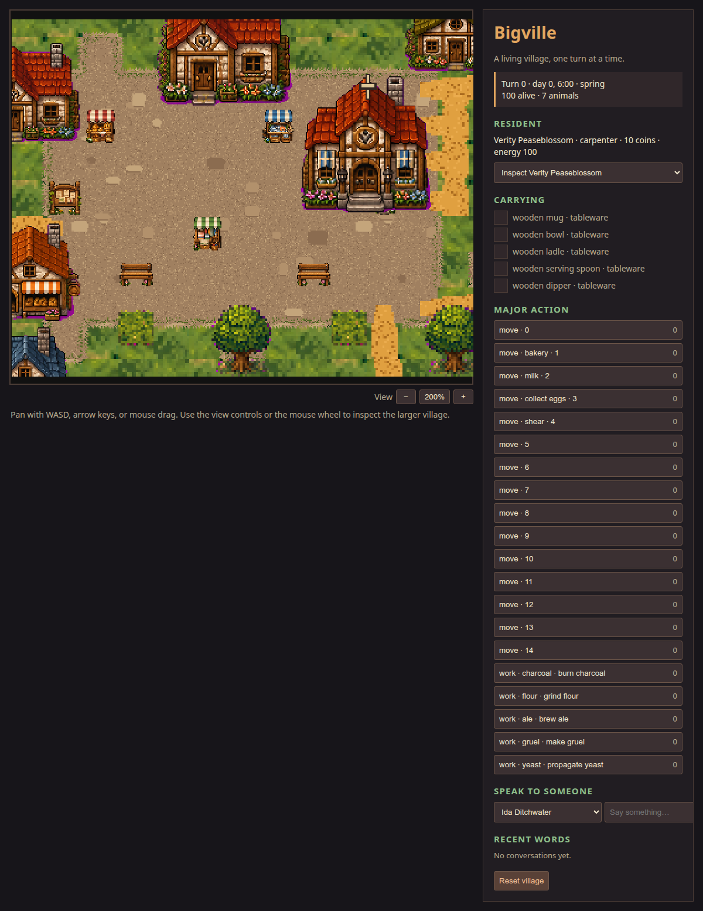
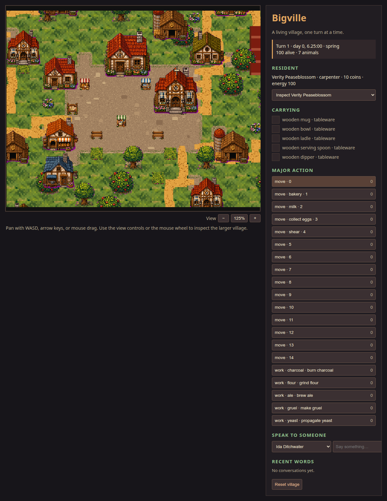

# Bigville

Bigville is a data-driven village simulation and game API. The canonical world
contains a map, residents, bodies, animals, farms, buildings, food production,
trade, storage, law, records, observations, affordances, and seeded resident
cognition. Actors are driven through a backend boundary: Ocelot, a human UI,
the deterministic game backend, or a future LLM backend can all propose the
same validated actions.

Recipe work follows that boundary too: the world publishes physically legal
recipes and validates explicit craft actions. It does not infer an actor's
demand beliefs, choose a recipe, or size a production run from town-wide
signals. Those expectations and choices belong to the actor's cognition
backend.

## A system for embodied agent research

Bigville provides a shared, persistent world in which an agent's cognition is
coupled to a simulated body. A resident has a position, physical needs and
capabilities, and acts among other residents, objects and institutions.
Observations and affordances come from that situation; actions are proposed by
the resident's backend, checked and enacted by the world, and their outcomes
change what can happen next. For example, food has to be reached, acquired and
eaten; exertion, exhaustion and injury have consequences; and objects and
resources remain in the world for other residents to encounter. The API is the
interface to this loop: the modeled body, environment and their interaction
give the actions their meaning.

This design makes Bigville useful as an experimental system for questions in
embodied cognition, artificial life and social simulation:

- **Perception and action:** how do limited observation, location, effort and
  changing bodily needs affect a resident's choices and its ability to learn
  what the world permits?
- **Cognition in context:** how do Ocelot, deterministic, human and LLM
  backends behave when situated in the same world, and how do their decisions
  change when resources, bodies or social surroundings change?
- **Social and institutional dynamics:** how do individual actions and their
  consequences accumulate into patterns of work, exchange, cooperation,
  conflict and governance in a shared village?
- **Experimental intervention:** how do outcomes change when a scenario,
  initial conditions, population or backend changes? Seeded scenarios,
  world reports and action outcomes support controlled runs and inspection of
  the resulting trajectories.

The intellectual grounding is the relationship between mind, body and world.
Varela, Thompson and Rosch's [*The Embodied Mind*](https://mitpress.mit.edu/9780262529365/the-embodied-mind/)
describes cognition and perception as arising through embodied, situated
activity. Gibson's [account of affordances](https://www.routledge.com/The-Ecological-Approach-to-Visual-Perception-Classic-Edition/Gibson/p/book/9781848725782)
connects opportunities for action to the relationship between an organism
and its environment. Brooks's [work on situated robotics](https://people.csail.mit.edu/brooks/papers/representation.pdf)
likewise makes ongoing perception and action central to intelligent behaviour.
Bigville takes these ideas as design influences: its bodies and environment
are computational models, and the system does not claim to reproduce lived
experience or establish that its agents are human-like.

The system is complementary to recent agent research. Park et al.'s
[*Generative Agents*](https://arxiv.org/abs/2304.03442) explores believable
social behaviour using language-model memories, reflection and planning in a
town. [*Emergence World*](https://arxiv.org/html/2606.08367v1) studies
long-horizon, heterogeneous agent populations using a persistent spatial
environment, memories, governance and context-gated tools. Bigville shares the
interest in agents acting together over time, while making a simulated body's
needs and capabilities, physical resources and world-side consequences a
foundation for the cognition loop. Emergence World also enforces contextual
preconditions; the difference is one of modeling emphasis, not a claim that
its agents lack a world or that an API cannot mediate embodied action.

The [feature plan](docs/FEATURE_PHASES.md) sets out further work on a limited
agent view, personas and routines, and comparative learning evaluation; these
are planned phases rather than claims about the current system. Research use
still requires explicit hypotheses, controls, repeated runs and validation
against appropriate observations.

The public API is in `bigville/`:

```python
from bigville import create_game

game = create_game(player="Ada", default_backend="cheap")
state = game.step()
```

The simulation also exposes a read-only statistical report. It contains an
exact census and physical/economic/social measurements, plus a deterministic
simple-random sample estimate with finite-population standard errors:

```python
report = game.world.report(sample_size=30, seed=7)
print(report["population"]["alive"])
print(report["economy"]["transactions"])
print(report["social"]["conversation"])
```

`run_village()` records compact period snapshots and deltas in the report's
`series` field. The same current report is available to clients at
`GET /api/report`; it does not advance the simulation or create world facts.

Bigville is standalone: its graph runtime, world mechanics, seed data, backend
protocol, persistence model, and tests are all in this repository. Cognition
providers may be embedded, remote, deterministic, human-driven, or backed by
another project; none is required to run the simulation.

## Play the village

The repository includes a playable Phaser 3 browser client. It uses the
canonical Python world over a small standard-library HTTP API.

```bash
python -m pip install -e .
python -m bigville.server
# open http://127.0.0.1:8765/
```

The cosy pixel-art terrain tiles, reusable building sprites, and supporting
sprite/icon sheets are included in the package. The client uses a square-cell
3/4 top-down presentation with a close 2x pixel-art scale, upright facades,
and row-based depth. It assembles the map from the scenario's exported grid
and building placements, so changing the world seed or scenario changes the
geography without requiring a new backdrop.
Use the action buttons to submit a major action, or speak to another resident;
autonomous deterministic residents take their own backend decisions on the
same turn.

Terrain movement is seeded data: paths have a faster, lower-effort travel
profile, while each map cell publishes its own speed and stamina multiplier.
The simple NPC backend uses that path preference when choosing comparable moves.

### Screenshots







The animation is produced from a live run of the client and backend:

```bash
python tools/record_game.py --turns 24
```

The recorder requires the optional local tools `playwright` and `Pillow`, plus
a Chromium-compatible browser.

Occupied buildings are rendered as open-roof rooms, so residents and their
interiors remain visible while the village continues to run.

The art scale and asset contract is documented in
[`docs/GAME_ART_DESIGN.md`](docs/GAME_ART_DESIGN.md). The item atlas is
generated from every entry in `domains/bigville_entities.ITEMS`; the inspector
shows bulk stock, discrete carried objects, and worn clothing. A held tool is
rendered on the resident, so a resident carrying a pick visibly has a pick.
The current art direction board is included at
[`bigville/game/assets/stardew_like_art_direction.png`](bigville/game/assets/stardew_like_art_direction.png);
the original village rendering is preserved as a reference at
[`bigville/game/assets/style_source_village.png`](bigville/game/assets/style_source_village.png),
but it is not drawn as a backdrop. `tools/build_style_assets.py` turns the
reference language into assembled material fields, terrain transitions, props,
and building facades. Broad surfaces are masked to the canonical map cells,
while paths are transparent topology-aware interfaces: their dirt footprint
connects to neighbouring path cells and leaves a grass shoulder at endpoints,
corners, and turns. This keeps grass, paths, water, soil, and stone from reading
as a checkerboard of independently stamped squares. Material boundaries also
get sparse pixel-art edge overlays on both sides, so grass does not meet stone,
soil, or water as a ruler-straight seam. It also includes matching roof-off cutaway facades with furnished
interiors, so scenarios can use different maps with the same cosy visual style
without falling back to a separate interior art language. Residents use a
32px directional walk-cycle atlas with idle, step-A, and step-B frames, so
movement is rendered as a short physical walk between simulation cells.
Common hand-held objects use a separate detailed atlas and are anchored to the
walking hand rather than floating at a fixed map offset.

## Cognition backends

`simple` (also spelled `cheap` for compatibility) selects the lightweight
deterministic NPC backend, suitable for low-cost residents and animal-style
policies. Selecting `ocelot` requires Ocelot's actual
`worlds.bigville_ocelot_adapter.BigvilleOcelotResident` and its dependencies;
the session raises `OcelotUnavailableError` instead of using a local fallback.
Put both repositories on `PYTHONPATH`. The current Ocelot adapter also reads
some seed files relative to the working directory, so run from the Ocelot
checkout. Scenario-authored backend choices take precedence over the default.

`BigvilleWorld.tick()` advances physical time and does not choose resident or
animal policies. `BigvilleGame` owns resident and animal backends, invokes them
for a successful turn, and submits their proposed actions to world-side
physical validation. The world publishes animal actions from adjacent legal
movement, reachable stocked feed, and available herding targets; hunger and
species preferences are backend motivations. Feeding consumes stock only when
the animal is within physical reach. For an unattended run, pass `autonomous=True` to `create_game`; Game sessions
advance metabolism and ecology once per 96 successful turns by default; set
`ticks_per_period` to another positive integer or `None` to manage periods
externally. A waiting human does not advance time. Residents must still acquire
and eat food through physical actions.

Scenarios can customise the deterministic policy using a backend factory and
`SimplePolicy`, both without changing world rules. For example:

```python
from bigville.backends import DeterministicBackend, SimplePolicy

factories = {"simple": lambda world, character: DeterministicBackend(
    character, policy=SimplePolicy(action_bonuses={"inspect": 50}))}
game = create_game(scenario="my_scenario", default_backend="simple",
                   backend_factories=factories, autonomous=True)
```

The bonus applies only when the world offers `inspect`; it does not create an
affordance or bypass physical admissibility. Scenario-authored backend choices
still override `default_backend`.

`DeterministicBackend` is the cheap, repeatable NPC backend. It maintains
needs-driven goals, changes priorities across morning/workday/evening/night,
chooses from the world's current legal affordances, and occasionally speaks in
structured social acts to nearby people. `LLMBackend` is a provider-neutral
adapter: pass an object with `complete(prompt)` and it will receive a versioned
JSON prompt containing the character state, public observations, world frames,
legal affordances, and recipient capabilities. The provider returns a JSON
`ActorResponse`.

Backends may return an optional `continuation` containing a physical
`destination` or repeatable `task`. Bigville reuses that plan without querying
cognition again until arrival or an unexpected encounter, hunger/energy
threshold, world event, or task failure. Set `poll_each_turn: true`, or
construct `BigvilleGame(..., continuations=False)`, for reactive
decide-every-turn behavior. Replayed actions still pass through the world's
admissibility and one-major-action rules.

### Real Ocelot integration

Bigville does not bundle the Ocelot substrate. The Ocelot repository provides
`worlds.bigville_ocelot_adapter.BigvilleOcelotResident`, which can be passed as
`cognition_factory` (or used through `create_bigville_board_game`). Physical
`read_object` actions then enter Ocelot's real deep document reader. Bigville
only records the returned graph evidence; its dependency-free fallback records
an explicit comprehension residual instead of claiming that stored prose was
understood.

## Development

```bash
python -m pip install -e .
python -m pytest -q
```

The backend and prompt work is staged in
[`docs/AGENT_BACKENDS_PLAN.md`](docs/AGENT_BACKENDS_PLAN.md).
